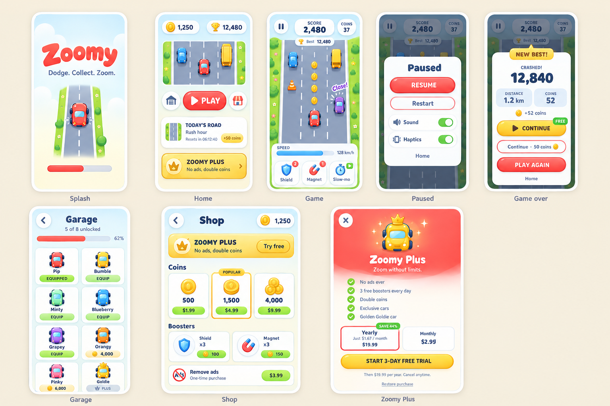

# Zoomy 🚗💨

> A modern, fast-paced casual 3-lane top-down car dodging game built natively for Android using **Kotlin** and **Jetpack Compose**.



---

## 🌟 Overview

**Zoomy** is designed from the ground up to deliver a delightful arcade experience with top-tier mobile polish. Featuring a custom deterministic 2D canvas game engine with fixed timestep physics, procedural vector rendering, dynamic obstacles, audio synthesis, and complete monetization frameworks.

---

## 🎮 Key Features

- 🏎️ **Fast-Paced 3-Lane Action**: Responsive touch and swipe lane switching with tilt dynamics and queuing.
- ⚙️ **Custom 2D Canvas Engine**: Fixed-timestep (`1/120s`) physics, collision detection, and smooth down-scrolling road mechanics.
- 💥 **Dynamic Hazards & Combos**: Spawned cars, trucks, and cones; near-miss close-call bonuses, and multipliers up to 5x.
- ⚡ **Active Boosters**:
  - **Shield**: Absorbs obstacle collisions.
  - **Magnet**: Pulls coins from across all lanes.
  - **2x Multiplier**: Doubles your run score.
- 🎨 **100% Procedural Vector Visuals**:
  - Crisp gradients, dynamic lighting, gloss highlights, drop shadows, and particle effects with zero heavy raster images.
  - 8 collectible toy cars: **Pip**, **Bumble**, **Minty**, **Blueberry**, **Grapey**, **Orangy**, **Pinky**, and **Goldie** (with roof crown).
  - Modern typography powered by **Baloo 2** and **Quicksand**.
- 🔊 **Procedural Audio & Haptics**: Real-time synthesized sound effects via Android `AudioTrack` PCM generation and tactile haptic feedback.
- 💰 **Monetization & Economy**:
  - Google Play Billing v7 (Consumable coin packs, "Remove Ads", and "Zoomy Plus" subscriptions with free trial).
  - Google Mobile Ads / AdMob (Rewarded revives/multipliers, interstitials, and GDPR UMP consent support).
  - Persistent player data saved via Jetpack DataStore Preferences.

---

## 📂 Repository Layout

```
.
├── Zoomy/                     # Root Android Studio project
│   ├── app/                   # Android application module
│   │   ├── src/main/java/     # Kotlin source code (game engine, UI, audio, ads, billing)
│   │   ├── src/main/res/      # Fonts (Baloo 2, Quicksand), drawables, icons, themes
│   │   └── src/test/java/     # Unit tests (deterministic engine physics & collisions)
│   ├── prompts/               # AI generation reference prompts & specifications
│   ├── AGENT_START.md         # Full design tokens and UI/UX design specifications
│   ├── SETUP.md               # Production release, AdMob, and Google Play Billing setup guide
│   ├── README.md              # Android project documentation
│   └── build.gradle.kts       # Gradle build configuration
├── zomy.png                   # 8-Screen visual reference & design showcase
└── README.md                  # Global repository documentation (this file)
```

---

## 🚀 Quick Start

### Requirements
- **Android Studio Ladybug (2024.2.1)** or newer
- **JDK 17**
- Android device or emulator with **API 26+** (Android 8.0 Oreo+)

### Build & Run
Navigate into the `Zoomy` project directory:

```bash
cd Zoomy
```

- **Compile Debug APK**:
  ```bash
  # Windows
  .\gradlew.bat assembleDebug

  # macOS / Linux
  ./gradlew assembleDebug
  ```

- **Run Unit Tests**:
  ```bash
  ./gradlew testDebugUnitTest
  ```

- **Install to Connected Device**:
  ```bash
  ./gradlew installDebug
  ```

---

## 📖 Additional Documentation

- [Zoomy Android Project README](Zoomy/README.md) – Detailed architecture breakdown and feature specifications.
- [Setup & Release Guide (SETUP.md)](Zoomy/SETUP.md) – Step-by-step instructions for production signing, Google Play Billing products, and AdMob unit IDs.
- [Agent Specifications (AGENT_START.md)](Zoomy/AGENT_START.md) – Design tokens, easing curves, component specs, and mechanics definitions.

---

## 📄 License

This repository is distributed under standard open-source terms. See project files for license details.
